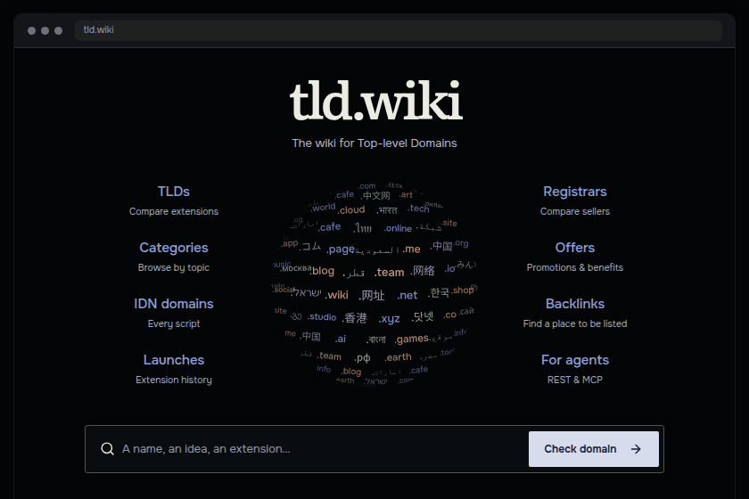
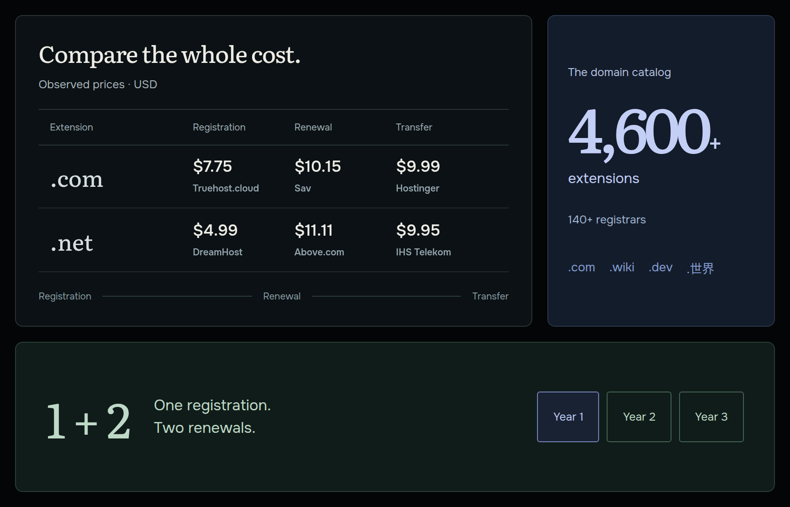
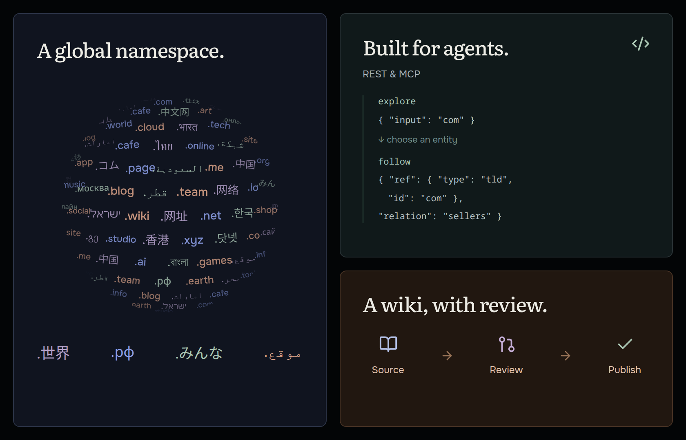

  <a href="https://tld.wiki">
    <picture>
      <source media="(prefers-color-scheme: dark)" srcset="assets/wordmark-dark.svg">
      <source media="(prefers-color-scheme: light)" srcset="assets/wordmark-light.svg">
      
    </picture>
  </a>

<strong>The wiki for Top-level Domains.</strong>

  <a href="https://tld.wiki/search">Check a domain</a> ·
  <a href="https://tld.wiki/registrars">Compare registrars</a> ·
  <a href="https://github.com/tld-wiki/community">Contribute</a>

  <a href="https://github.com/tld-wiki/.github/blob/main/profile/assets/lookup.mp4">
    <picture>
      <source media="(max-width: 600px)" srcset="assets/lookup-mobile.gif">
      
    </picture>
  </a>

Find a name. Compare the options.

  <a href="https://tld.wiki/#catalog-heading">
    <picture>
      <source media="(max-width: 600px)" srcset="assets/cost-mobile.png">
      
    </picture>
  </a>

Compare the whole cost: registration, renewal and transfer.

  <a href="https://tld.wiki/agents">
    <picture>
      <source media="(max-width: 600px)" srcset="assets/knowledge-mobile.png">
      
    </picture>
  </a>

A global namespace. Explore on the web or through <a href="https://tld.wiki/agents">REST & MCP</a>.

  <a href="https://github.com/tld-wiki/community">Suggest an edit, registrar, backlink destination or translation</a> 
  Sources first. Maintainer review before publication.

  <a href="https://status.tld.wiki">Service status</a> · Made with 🌐 by <a href="https://u.software">u.software</a>

